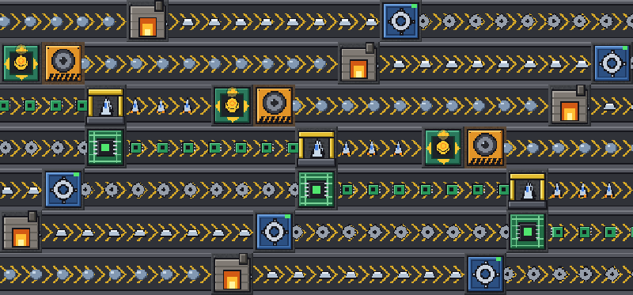
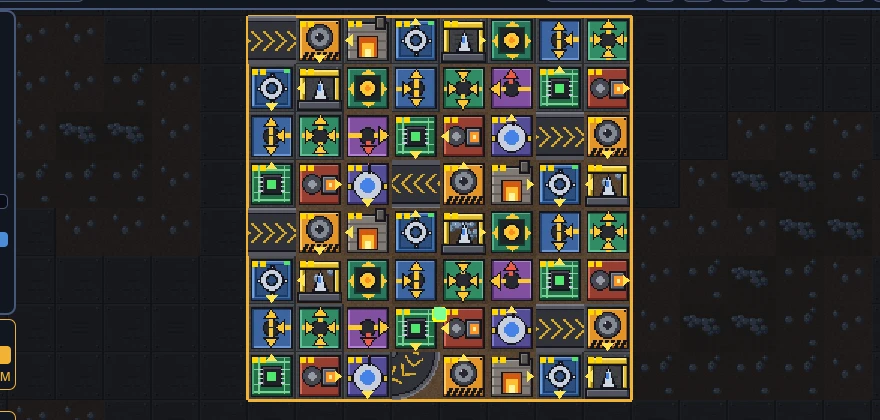
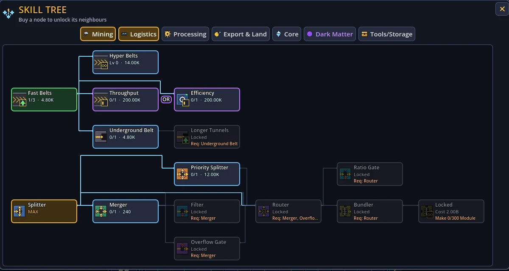
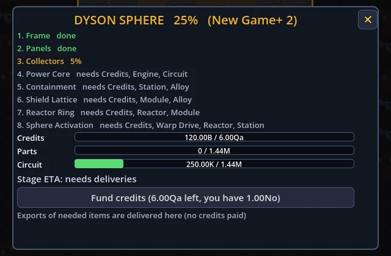
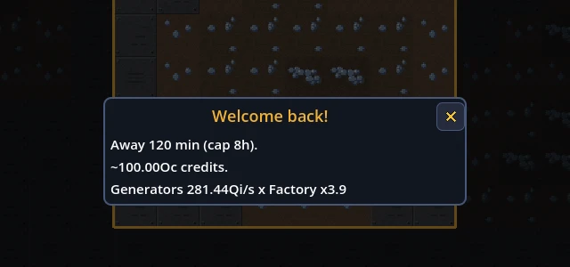

<h1 align="center">Starforge</h1>

<b>Click a rock. Build a factory. Wrap a star.</b>

  <a href="https://github.com/xxalex3xx97/starforge-releases/releases/latest/download/Starforge.exe"><b>Download for Windows</b></a>
  &nbsp;·&nbsp;
  <a href="https://github.com/xxalex3xx97/starforge-releases/releases">All releases</a>
  &nbsp;·&nbsp;
  <a href="https://xxalex3xx97.github.io/starforge-releases/">Website</a>

An idle factory game for Windows. Start with a single click on a core, grow it into a belt-fed machine empire that keeps running while you are away, and spend it all on one goal: a Dyson Sphere.

## How a run goes

1. **Click** the core for credits, build a combo, buy generators.
2. **Automate** with belts, splitters, mergers and routers: miners feed smelters, smelters feed assemblers, the shipyard feeds export.
3. **Prestige** for Dark Matter, a permanent multiplier.
4. **Dyson**: build the sphere stage by stage, then start over with New Game+.

## A factory with no edge

Buy land to push the map outward and keep building. Belts, splitters, mergers, underground tunnels, storage crates, bundlers and ratio gates all have a job.

## A skill tree that makes you choose

Seven tabs of nodes. Some come in exclusive OR pairs: pick one and the other is gone until you prestige.

## Finish the Dyson Sphere

Eight stages: Frame, Panels, Collectors, Power Core, Containment, Shield Lattice, Reactor Ring, Sphere Activation.

## It keeps working while you don't

Your factory keeps earning while the game is closed, for up to eight hours.

## Install

Download `Starforge.exe` and run it. No installer, Windows 10 / 11. The game checks for updates on its own. The build is unsigned, so Windows SmartScreen may warn on first run: choose *More info*, then *Run anyway*.

Source is private.
